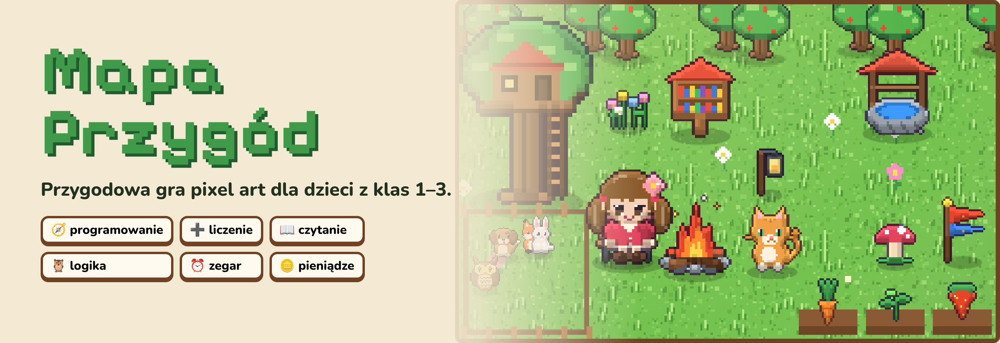
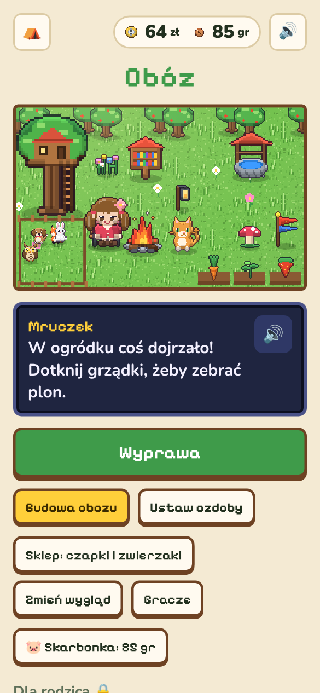
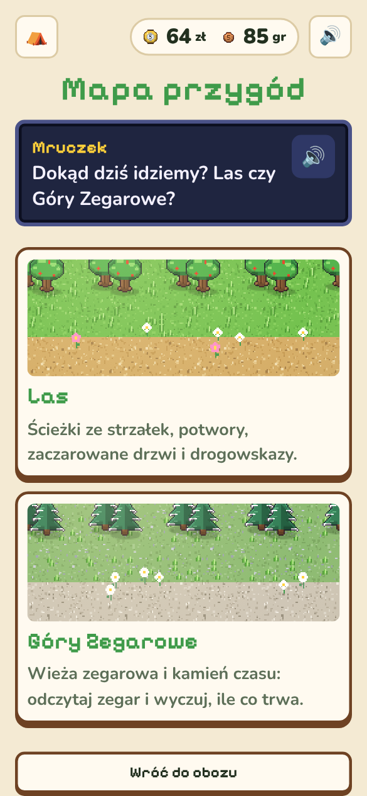
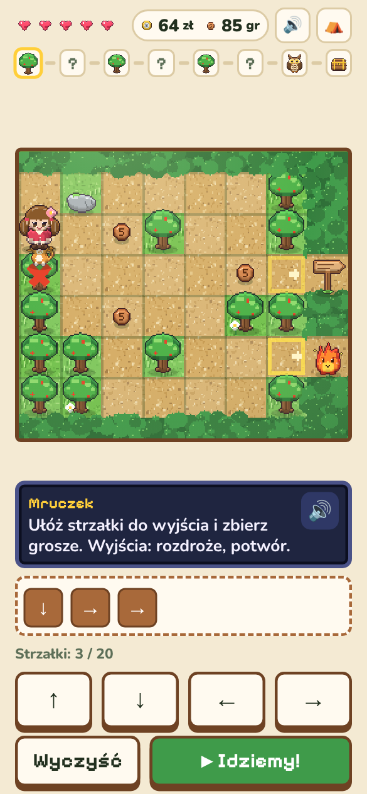
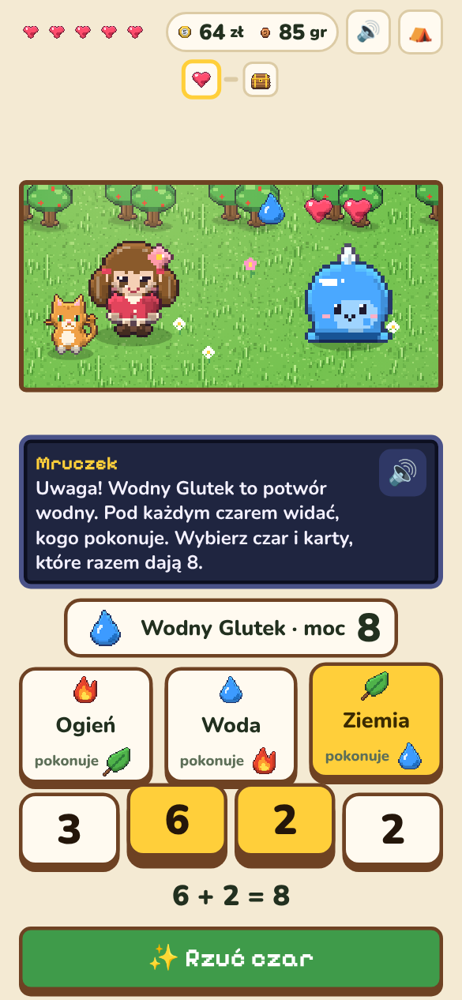
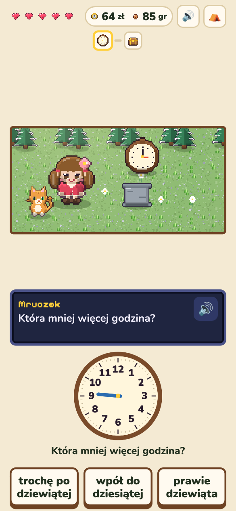
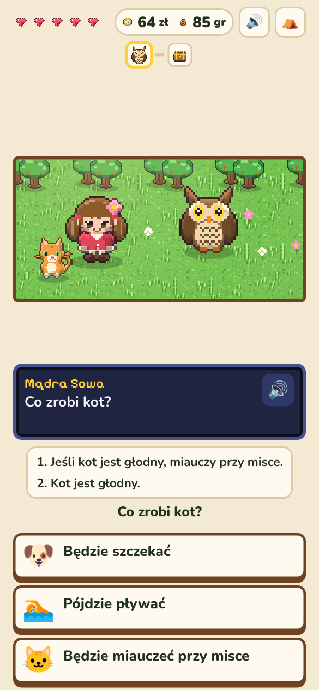
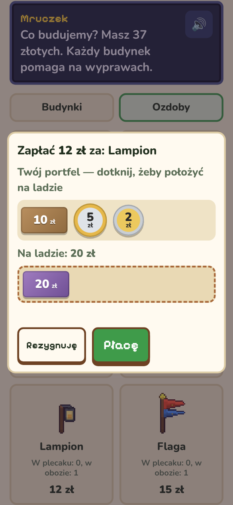
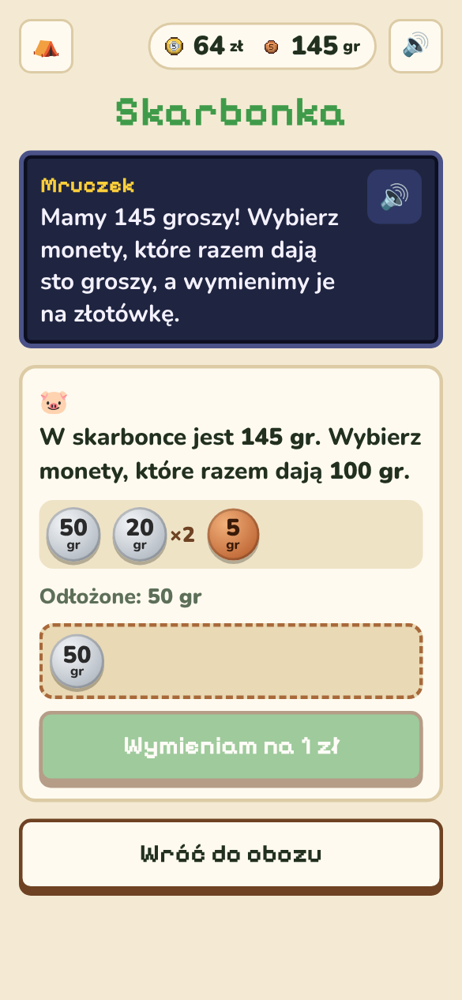
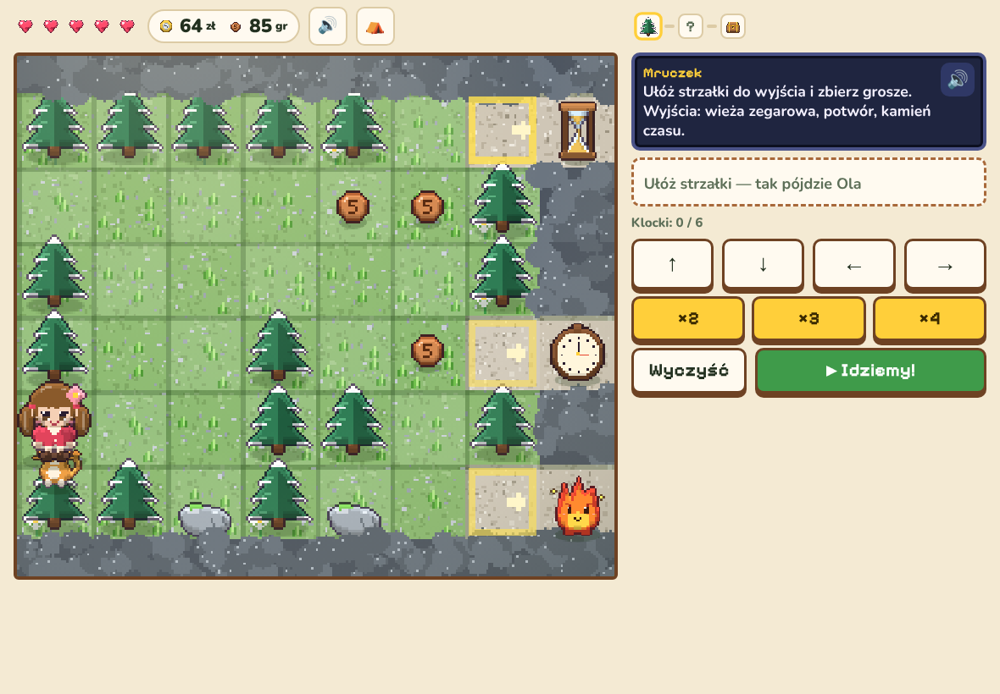

<p align="center"></p>

<p align="center">
  <b>Ułóż drogę ze strzałek. Pokonaj potworka liczeniem. Otwórz zaczarowane drzwi słowem.<br>Zbuduj obóz za uczciwie zarobione złotówki.</b>
</p>

<p align="center">
  
  
  
  
</p>

---

## 🗺️ O co chodzi w grze

Dziecko z ulubionym zwierzakiem wyrusza na wyprawę. Każda wyprawa to kilka pokoi: najpierw trzeba **zaprogramować drogę** strzałkami, potem wybrać wyjście i zmierzyć się z tym, co za nim czeka: **potworem** pokonywanym liczeniem, **zaczarowanymi drzwiami** otwieranymi słowem albo **rozdrożem** z podobnymi drogowskazami. Przed skrzynią ze skarbem **Mądra Sowa** zadaje zagadki logiczne. Za zarobione złotówki dziecko rozbudowuje **obóz**: dom, studnię, ogródek, biblioteczkę i zagrodę dla zwierzaków.

Gra **wspiera szkołę, ale jej nie zastępuje**. Wyprawa trwa 10–15 minut i ma wyraźny koniec, a gra nie ma codziennych nagród za logowanie ani losowych skrzynek.

## 📸 Jak to wygląda

<table>
  <tr>
    <td align="center" width="33%"><br><b>Obóz</b><br><sub>Buduje się go za złotówki z wypraw</sub></td>
    <td align="center" width="33%"><br><b>Mapa przygód</b><br><sub>Las i Góry Zegarowe</sub></td>
    <td align="center" width="33%"><br><b>Ścieżka</b><br><sub>Program ze strzałek prowadzi bohaterkę</sub></td>
  </tr>
  <tr>
    <td align="center"><br><b>Potwór</b><br><sub>Dobierz czar i karty, które dają jego moc</sub></td>
    <td align="center"><br><b>Wieża zegarowa</b><br><sub>Odczytaj, ustaw, policz, o której koniec</sub></td>
    <td align="center"><br><b>Mądra Sowa</b><br><sub>Połącz wskazówki i rozwiąż zagadkę</sub></td>
  </tr>
  <tr>
    <td align="center"><br><b>Zakupy</b><br><sub>Odlicz monety, policz resztę</sub></td>
    <td align="center"><br><b>Skarbonka</b><br><sub>Sto groszy to jedna złotówka</sub></td>
    <td align="center" valign="middle"><sub>Na tablecie w poziomie scena jest po lewej, a przyciski po prawej:</sub><br><br></td>
  </tr>
</table>

## 🎒 Czego się uczy

| | W grze |
| --- | --- |
| 🧭 **Programowanie** | Kolejność kroków, pętle (×2, ×3, ×4), klocek „aż do przeszkody”, szukanie najkrótszej drogi |
| ➕ **Matematyka** | Dodawanie i odejmowanie, brakująca liczba, „3 × 5 gr = 15 gr” |
| 🪙 **Pieniądze** | Prawdziwe monety i banknoty, płacenie, reszta, wymiana 100 gr na 1 zł |
| ⏰ **Czas** | Zegar ze wskazówkami (pełne godziny i połówki), „o której się skończy”, ile co trwa, wyczucie sekund |
| 📖 **Polski** | Układanie słów z liter, czytanie podobnych wyrazów, zagadki do hasła skrzyni |
| 🦉 **Logika** | „Kto to zrobił?” z kilku wskazówek, ciągi, co nie pasuje, „jeśli… to…” |

Kolejne zadania powstają z myślą o [nowej podstawie programowej](https://mscdn.pl/wp-content/uploads/2026/05/edukacja_wczesnoszkolna.pdf) dla klas 1–3, obowiązującej od września 2026 roku. Gra nie przerabia jej całej: ćwiczy to, w czym zabawa naprawdę pomaga. Każde zadanie czyta na głos zwierzak, więc dziecko, które dopiero uczy się czytać, też sobie poradzi.

## 👨‍👩‍👧 Dla rodzica

- **PIN rodzica** ustawiasz przy pierwszym uruchomieniu. Otwiera panel „Dla rodzica 🔒” na dole obozu.
- **W panelu ustawisz poziom trudności** (1–3), włączysz lub wyłączysz dźwięki, zmienisz PIN i usuniesz gracza.
- **Kilkoro dzieci na jednym urządzeniu:** każde ma swoją postać i swoje postępy. Na starcie wybiera się, kto gra.
- **Kopia zapisu:** postępy są tylko w przeglądarce, w której dziecko gra. Przed wyczyszczeniem przeglądarki albo zmianą urządzenia zrób w panelu „Zrób kopię zapisu” i wczytaj ją na nowym urządzeniu.
- **Pomyłki są w porządku:** zła odpowiedź kosztuje najwyżej serduszko, nigdy cały postęp.

> PIN to zamek na dziecko, a nie zabezpieczenie przed dorosłym. Do twardego limitu czasu przed ekranem służą ustawienia telefonu: Family Link na Androidzie albo Czas przed ekranem na iPadzie.

---

## 🛠️ Instalacja

Wybierz jeden z trzech sposobów. **Nikt nie dostaje dostępu do Twojej gry ani do postępów Twojego dziecka:** każda rodzina uruchamia własną kopię.

| Sposób | Dla kogo | Trudność |
| --- | --- | --- |
| [1. Plik na komputerze](#1-plik-na-komputerze) | Szybka próba na laptopie | ⭐ |
| [2. Własna strona na GitHubie](#2-własna-strona-na-githubie-za-darmo) | Gra na tablecie i telefonie, z każdego miejsca | ⭐⭐ |
| [3. Domowy serwer](#3-domowy-serwer-docker) | Masz w domu serwer z Dockerem | ⭐⭐⭐ |

### 1. Plik na komputerze

Cała gra to **jeden plik**. Nie trzeba niczego instalować.

1. Otwórz plik [`dist/index.html`](dist/index.html) w tym repozytorium.
2. Kliknij przycisk **Pobierz** (strzałka w dół, „Download raw file”) w prawym górnym rogu podglądu.
3. Otwórz pobrany plik dwuklikiem. Uruchomi się w przeglądarce.

Postępy zapisują się w tej przeglądarce, na tym komputerze. Na tablecie i telefonie otwieranie plików z dysku działa kiepsko, więc tam wybierz sposób 2.

### 2. Własna strona na GitHubie (za darmo)

Gra dostanie własny adres, np. `https://twoj-login.github.io/mapa-przygod/`, który otworzysz na każdym urządzeniu. Wystarczy darmowe konto na GitHubie.

1. Zaloguj się na [github.com](https://github.com) (albo załóż konto).
2. Na górze tej strony kliknij **Fork**, a potem **Create fork**. Powstanie Twoja kopia gry.
3. W swojej kopii otwórz **Settings → Pages**. W polu **Source** wybierz **GitHub Actions**.
4. Przejdź do zakładki **Actions**. Jeśli GitHub pyta, kliknij zielony przycisk, który włącza akcje. Wybierz **Strona gry (GitHub Pages)**, a potem **Run workflow → Run workflow**.
5. Po 1–2 minutach przy zadaniu pojawi się zielony znaczek ✓, a w **Settings → Pages** adres Twojej gry.
6. Otwórz ten adres na tablecie i dodaj grę do ekranu głównego:
   - **iPad / iPhone (Safari):** przycisk udostępniania → **Do ekranu początkowego**.
   - **Android (Chrome):** menu ⋮ → **Dodaj do ekranu głównego** albo **Zainstaluj aplikację**.

Od tej chwili gra uruchamia się jak aplikacja i działa także bez internetu.

> Na darmowym koncie GitHub udostępnia strony tylko z **publicznych** repozytoriów. Publiczny jest wtedy sam kod gry, a postępy dziecka zostają na jego urządzeniu.

### 3. Domowy serwer (Docker)

Na serwerze z Dockerem (np. z Portainerem):

```bash
git clone https://github.com/atath/mapa-przygod.git
cd mapa-przygod
docker compose up -d --build
```

Gra będzie pod adresem `http://<adres-serwera>:8080`. Inny port ustawisz w pliku `docker-compose.yml`.

**Portainer:** **Stacks → Add stack → Repository**, adres repozytorium jak wyżej, plik `docker-compose.yml`, potem **Deploy the stack**.

**Aktualizacja do nowej wersji:**

```bash
cd mapa-przygod
git pull
docker compose up -d --build
```

> **Tryb offline i instalacja jako aplikacja działają tylko przez https.** Przy zwykłym `http://192.168…` gra działa normalnie, ale potrzebuje sieci i nie da się jej dodać do ekranu jak aplikacji. Jeśli masz już odwrotne proxy z certyfikatem (Nginx Proxy Manager, Caddy, Traefik albo Cloudflare Tunnel), wystaw przez nie port 8080.

---

## 🔄 Zapis gry i przenosiny

Postępy są zapisane **w przeglądarce, pod konkretnym adresem gry**. Inna przeglądarka, inne urządzenie albo inny adres (np. przejście z pliku na stronę) to osobny, pusty zapis. Żeby przenieść postępy:

1. Na starym miejscu: **Dla rodzica → Zrób kopię zapisu → Pobierz plik** albo **Kopiuj tekst**.
2. Na nowym miejscu: **Dla rodzica → Wczytaj zapis**, wybierz plik albo wklej tekst.

Wczytanie można cofnąć przyciskiem **Przywróć poprzedni zapis** w tym samym panelu.

## 🔒 Prywatność

Gra nie ma kont, reklam, analityki ani połączeń z zewnętrznymi serwisami. Nie wysyła nigdzie żadnych danych. Wszystko, co dziecko zrobi w grze, zostaje na jego urządzeniu.

## 🧑‍💻 Dla programistów

Budowanie, testy (gra jest testowana automatycznie w prawdziwej przeglądarce) i struktura kodu: [docs/DEVELOPERS.md](docs/DEVELOPERS.md).

## 📜 Licencja

Kod gry jest na licencji [MIT](LICENSE): możesz ją za darmo uruchamiać, zmieniać i przekazywać dalej, także innym rodzinom i szkołom, pod warunkiem zachowania informacji o autorze.

## 🎨 Grafika i czcionki

Cała grafika (postacie, potworki, zwierzaki, obóz) jest narysowana kodem na potrzeby tej gry. Grafika jest objęta tą samą licencją MIT co kod. Czcionki [Pixelify Sans](https://fonts.google.com/specimen/Pixelify+Sans) i [Nunito](https://fonts.google.com/specimen/Nunito) mają własną licencję, SIL Open Font License, i MIT ich nie obejmuje.
